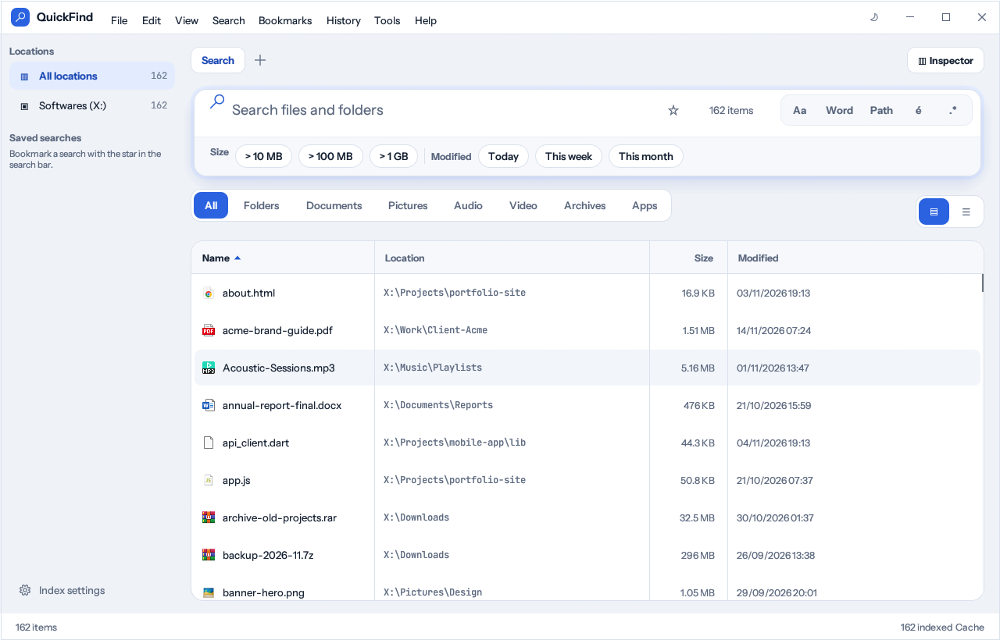
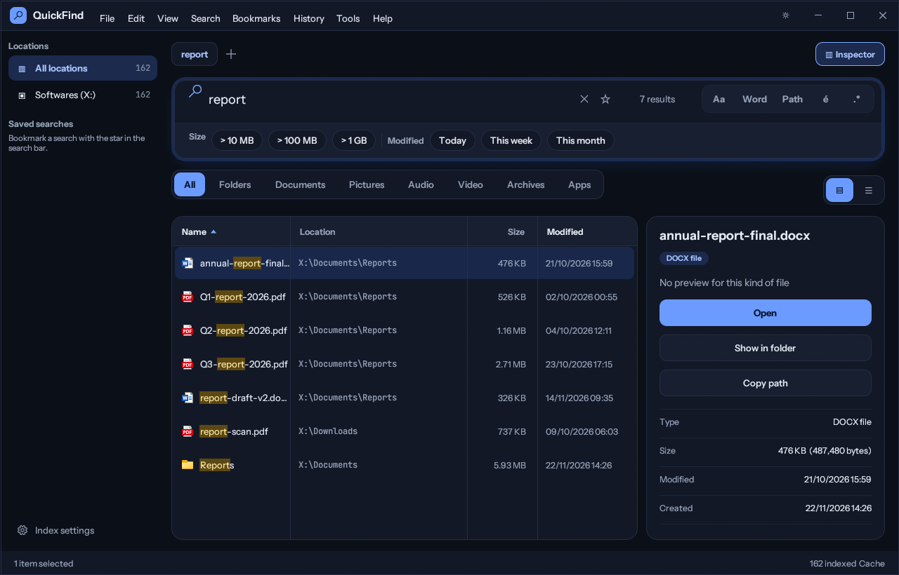
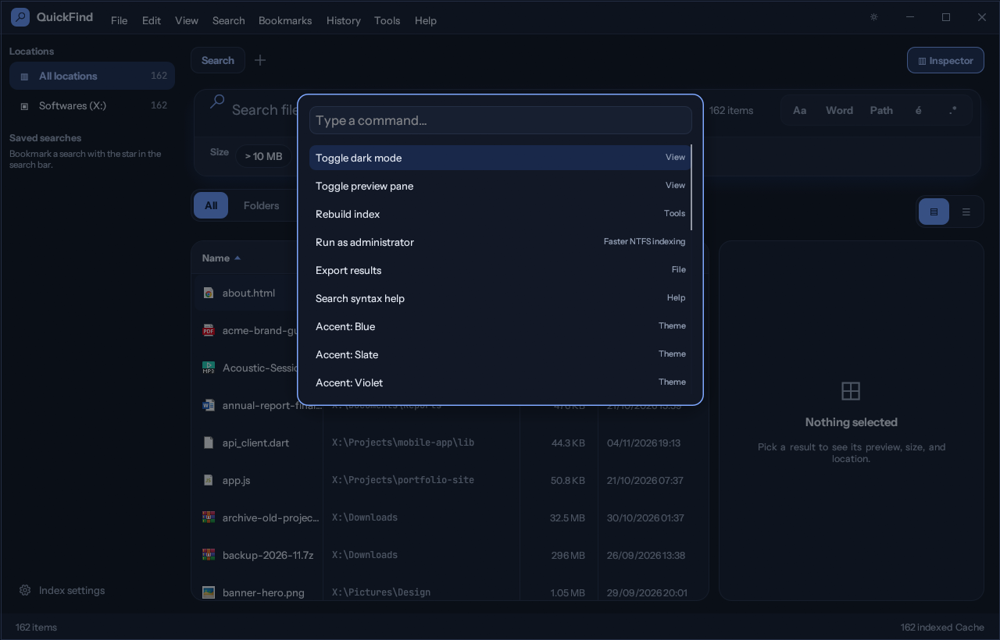
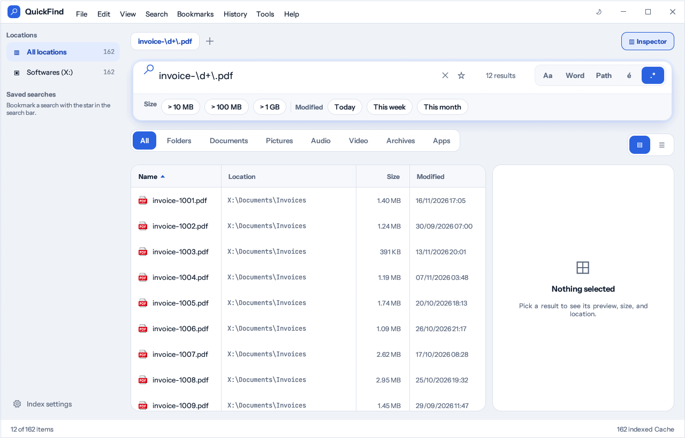
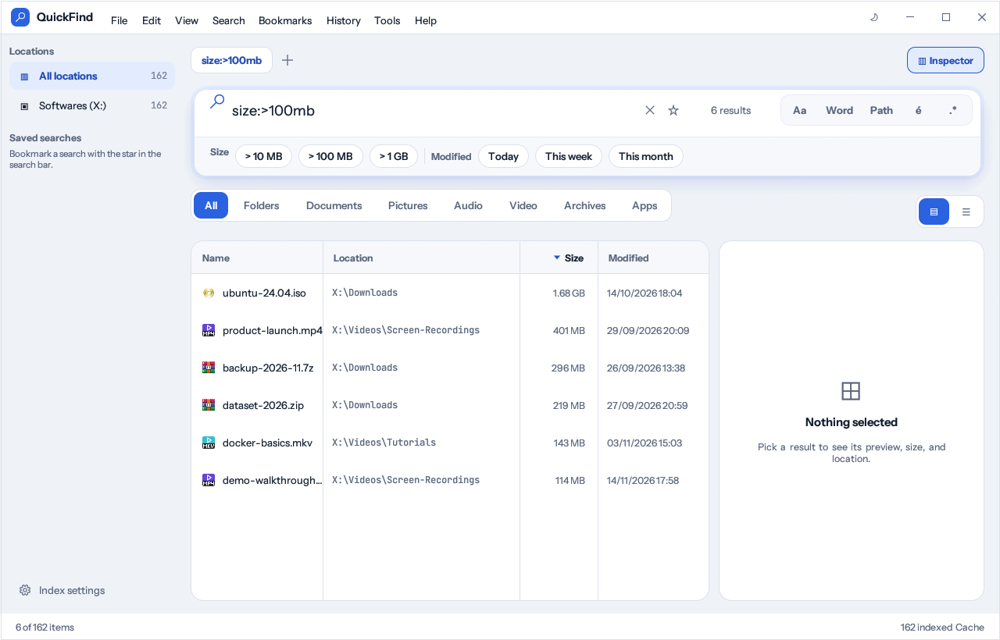
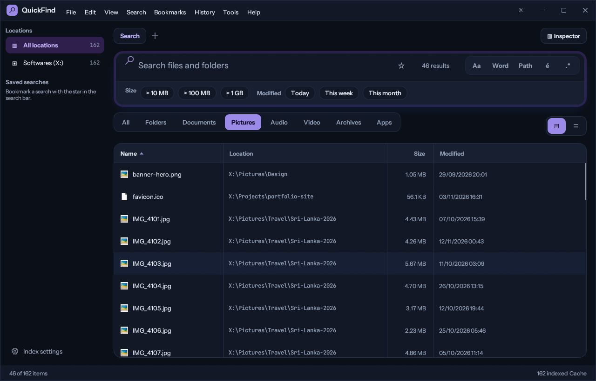

<div align="center">


# QuickFind

### Find any file on your PC in milliseconds. Light on RAM. Built for Windows.

A native, instant file-name search engine written in **Rust**.
It indexes **millions of files in seconds**, searches them **as you type**, and stays out of your way.

[](#-install)
[](#-tech-stack)
[](https://github.com/lakmina456/QuickFind/releases)
[](https://github.com/lakmina456/QuickFind/releases)
[](https://github.com/lakmina456/QuickFind/stargazers)

[**Download**](https://github.com/lakmina456/QuickFind/releases/latest) ·
[**Features**](#-features) ·
[**Search syntax**](#-search-syntax) ·
[**Benchmarks**](#-benchmarks) ·
[**Build from source**](#-build-from-source)

<br/>



</div>

---

## Why QuickFind?

Windows search is slow, and most "fast" search tools are heavy, ad-filled, or need a service running in the background.
QuickFind is the opposite:

| | |
|---|---|
| **Instant** | Results update on every keystroke. Searching ~3.2 million entries takes **6 to 42 ms** on the benchmark below. |
| **Light** | One portable **~20 MB `.exe`**. No installer, no service, no telemetry. About **290 MB of RAM for 3.2 million files** (see [benchmarks](#-benchmarks)). |
| **Always current** | A file-system watcher keeps the index live. The index is cached on disk, so the next start is ready in about **half a second**. |
| **Powerful** | AND / OR / NOT, wildcards, regex, size and date filters, duplicate finder, content search and more. |
| **Pleasant** | Modern UI with light and dark themes, five accent colors, a live inspector and a command palette. |

---

## Screenshots

<div align="center">

**Dark theme with live inspector.** Matches are highlighted as you type.



<br/><br/>

**Command palette (`Ctrl+K`).** Every action is a few keystrokes away.



<br/><br/>

<table>
<tr>
<td align="center"><b>Regex search</b><br/></td>
<td align="center"><b>Size filter, biggest first</b><br/></td>
</tr>
<tr>
<td align="center" colspan="2"><b>Type filters and accent colors</b><br/></td>
</tr>
</table>

<sub>Screenshots use a sample folder of demo files, not a real machine.</sub>

</div>

---

## Features

**Search**
- Instant search-as-you-type over every file and folder on your fixed drives
- Operators `space` (AND), `|` (OR), `!` (NOT), `< >` grouping, `"exact phrase"`, and `*` / `?` wildcards
- Match case, whole word, full path, diacritics and **regular expressions**, each one toggle away
- Functions such as `ext:`, `size:`, `dm:` (date modified), `dc:`, `infolder:`, `len:`, `attrib:`, `empty:` and `dupe:`
- Optional **file-content search**
- Size chips (`> 10 MB`, `> 100 MB`, `> 1 GB`) and date chips (`Today`, `This week`, `This month`)
- Type pills: Folders, Documents, Pictures, Audio, Video, Archives, Apps

**Productivity**
- Multiple search **tabs** (`Ctrl+T`)
- **Bookmarks** (saved searches) and search **history**
- Built-in reports: *Biggest files, Biggest folders, Duplicate names, Empty folders, Changed today*
- **Inspector** pane with file details and image preview, plus *Open*, *Show in folder* and *Copy path*
- **Export** results to CSV
- **Command palette** (`Ctrl+K`)
- Sort by any column, show or hide columns, comfortable or compact rows

**Native Windows integration**
- **System tray** with a global hotkey: `Ctrl+Alt+Space` summons it from anywhere
- Can keep running in the background when you close the window
- Real file-type icons from the shell
- Per-drive switches, exclude folders, and skip hidden, system or junk files (Temp, caches, `node_modules`, `.git`)

**Look and feel**
- Light and dark themes, five accent colors (Blue, Slate, Violet, Orange, Teal)
- Custom title bar and smooth scrolling over millions of rows

---

## Benchmarks

Measured on a real Windows 11 machine, indexing **every file on two drives**: **3,223,213 entries** (about 402,000 folders). Numbers come from the app's built-in `--build-index` report and a Task Manager style working-set measurement of the running app.

| Metric | Result |
|---|---|
| Full scan, warm cache | **4.4 s** |
| Full scan, cold | **11.9 s** |
| Load saved index at startup | **0.5 s** |
| Memory (working set) with the full index loaded | **about 290 MB** (steady for 40 s) |
| Executable size | **about 20 MB**, single file |

Query latency over the full 3.2 M-entry index:

| Query | Results | Time |
|---|---:|---:|
| `report` | 3,581 | **9 ms** |
| `*.png` | 79,570 | **10 ms** |
| `ext:jpg;png` | 81,317 | **11 ms** |
| `size:>100mb` | 463 | **6 ms** |
| `dm:thisweek` | 160,075 | **7 ms** |
| `<foo\|bar> !node_modules` | 9,494 | **14 ms** |
| `windows\ system32\ .dll` (path match) | 7,090 | **42 ms** |

> Results vary with hardware, drive speed and how many files you have. Memory grows roughly in proportion to the number of indexed files and folders. Reproduce these numbers yourself with `QuickFind.exe --build-index`.

### Why it stays lean
- The index is a **compact in-memory table** of fixed-size entries pointing into one shared string buffer, with no per-file heap allocation.
- Directory scanning is **parallel** (rayon), and the cache loads from a single binary file.
- The UI is an immediate-mode GPU renderer, so there is no web view and no runtime to ship.
- Only the visible rows are drawn, so a million results scroll as smoothly as ten.

---

## Install

1. Open the [**latest release**](https://github.com/lakmina456/QuickFind/releases/latest).
2. Download **`QuickFind.exe`** (or the `.zip`).
3. Run it. There is no installer. The first launch builds the index, which takes a few seconds.

> Windows SmartScreen may warn about an unsigned app on first run. Choose **More info, then Run anyway**.

**Command line**

```powershell
QuickFind.exe -search "invoice" -filter Documents -sort size -dark
QuickFind.exe -s "ext:png dm:thismonth" -accent violet
QuickFind.exe -regex -search "^IMG_\d{4}\.jpg$"
```

| Flag | What it does |
|---|---|
| `-s`, `-search <text>` | Start with a query |
| `-filter <name>` | Start on a type filter (`Documents`, `Picture`, `Video` ...) |
| `-sort <column>` | `name`, `path`, `size`, `ext`, `dm`, `dc`, `attributes` |
| `-sort-ascending` / `-sort-descending` | Sort direction |
| `-case`, `-ww`, `-matchpath`, `-diacritics`, `-regex` | Turn search options on (`-no...` turns them off) |
| `-dark` / `-light`, `-accent <name>` | Theme and accent |
| `-inspector`, `-palette`, `-selectfirst` | Open the inspector or palette, select the first result |

---

## Search syntax

| You type | It finds |
|---|---|
| `report 2026` | names containing both words |
| `png \| jpg` | either one |
| `invoice !draft` | `invoice` but not `draft` |
| `"annual report"` | the exact phrase |
| `*.pdf` | all PDFs (wildcards match the whole name) |
| `ext:jpg;png;webp` | those extensions |
| `size:>100mb` | bigger than 100 MB (also `tiny`, `small`, `large`, `huge`, `a..b`) |
| `dm:thisweek` | modified this week (also `today`, `last3days`, `2026-05`, `a..b`) |
| `infolder:D:\Projects` | directly inside a folder |
| `dupe:` | names that appear more than once |
| `empty:` | empty folders |
| `regex:^IMG_\d+` | a regular expression |
| `pic:` `audio:` `video:` `doc:` `zip:` `exe:` | built-in type macros |

**Shortcuts:** `Ctrl+F` focus search · `Ctrl+K` palette · `Ctrl+T` new tab · `Ctrl+I` case · `Ctrl+B` whole word · `Ctrl+U` path · `Ctrl+M` accents · `Ctrl+R` regex · `Ctrl+Alt+Space` show or hide from anywhere

---

## Tech stack

| Layer | Choice |
|---|---|
| Language | **Rust** (2021 edition) |
| UI | [`egui` / `eframe`](https://github.com/emilk/egui) with an OpenGL (glow) backend |
| Parallelism | [`rayon`](https://github.com/rayon-rs/rayon) for the directory scan and search |
| Live updates | [`notify`](https://github.com/notify-rs/notify) file-system watcher |
| Windows APIs | [`windows-sys`](https://github.com/microsoft/windows-rs): shell icons, tray, global hotkey, drives, registry |
| Regex | [`regex`](https://github.com/rust-lang/regex) |

```
app/
├─ src/
│  ├─ scan.rs        parallel drive scanner and indexing rules
│  ├─ index.rs       compact in-memory index and on-disk cache
│  ├─ query.rs       query parser (operators, functions, wildcards)
│  ├─ search.rs      background search thread and sorting
│  ├─ watch.rs       live file-system updates
│  ├─ tray.rs        system tray and global hotkey
│  └─ ui*.rs         window, tabs, results table, inspector, palette
└─ assets/           icon and fonts
```

---

## Build from source

You need [Rust](https://rustup.rs) (stable).

```powershell
git clone https://github.com/lakmina456/QuickFind.git
cd QuickFind/app
cargo build --release
# result: app/target/release/QuickFind.exe
```

Run the unit tests with `cargo test`.

> The repo pins the GNU toolchain in `app/rust-toolchain.toml` so it builds without Visual Studio. The app icon is embedded in every Windows build (no `rc.exe` required). On a machine with the MSVC toolchain you can override it, for example `set RUSTUP_TOOLCHAIN=stable-x86_64-pc-windows-msvc`.

### Publishing a release

Push a version tag and the workflow in `.github/workflows/release.yml` builds `QuickFind.exe` and attaches it to a GitHub Release.

```powershell
git tag v0.1.0
git push origin v0.1.0
```

---

## Roadmap

- [ ] NTFS MFT / USN-journal indexing for near-instant first scans (run as administrator)
- [ ] Code-signed releases
- [ ] Installer and `winget` package
- [ ] Optional search result previews for more file types

Ideas and bug reports are welcome. Open an [issue](https://github.com/lakmina456/QuickFind/issues).

---

## Contributing

1. Fork the repo and create a branch: `git checkout -b feature/my-idea`
2. Make your change and run `cargo test`
3. Open a pull request

---

## Star history

If QuickFind saves you time, a ⭐ helps other people find it.

<a href="https://star-history.com/#lakmina456/QuickFind&Date">
  <picture>
    <source media="(prefers-color-scheme: dark)" srcset="https://api.star-history.com/svg?repos=lakmina456/QuickFind&type=Date&theme=dark" />
    <source media="(prefers-color-scheme: light)" srcset="https://api.star-history.com/svg?repos=lakmina456/QuickFind&type=Date" />
    
  </picture>
</a>

<div align="center">
<sub>Made with Rust for Windows.</sub>
</div>
